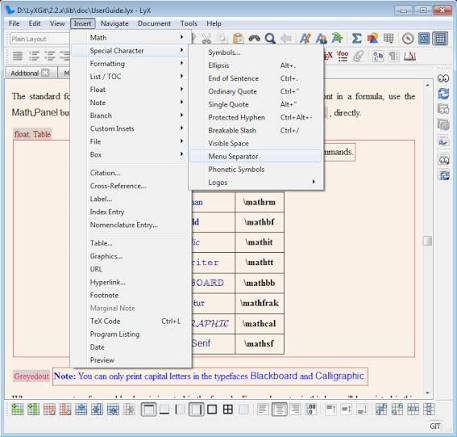
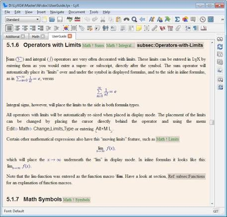

# LyX Document Processor for Structured Scientific Writing

Write articles, theses, books, and mathematical documents with a graphical editor backed by LaTeX.
LyX assigns meaning to document elements while the typesetting system produces the final pages.

[](https://github.com/LyX-software/LyX-editor/releases/)

[Document Model](#document-model) • [Mathematics](#mathematics-and-technical-content) • [Export](#export-and-command-line-workflows) • [Contributing](#contributing) • [License](#license)

## Document Model

The LyX editor separates the structure you author from the appearance of the finished document.
Choose a paragraph's role, such as section heading, quotation, or caption, instead of formatting every instance manually.

LyX WYSIWYM means "What You See Is What You Mean."
The editing view communicates structure; PDF output provides the final typeset result.

### Structure That Survives Revision

- Organize chapters and sections through the document outliner.
- Give equations and figures labels that references can follow.
- Generate a table of contents from the heading hierarchy.
- Keep bibliographic records separate from the prose that cites them.



The workflow suits documents that change repeatedly during drafting.
Moving a section should not require manually renumbering every reference to it.

## Document Classes and Writing Tasks

A document class defines the available structural elements and the rules used to typeset them.
Select a class that matches the intended publication before making extensive layout changes.

| Writing task | Structural focus | Useful review before export |
| --- | --- | --- |
| Research article | Sections, equations, citations | Journal class and bibliography style |
| Thesis | Chapters, references, appendices | Institutional requirements and numbering |
| Technical book | Hierarchy, figures, index | Cross-references and chapter organization |
| Lecture notes | Definitions, examples, mathematics | Equation labels and consistent notation |
| Presentation | Frames and concise content | Beamer layout and projected readability |
| Letter | Address and correspondence elements | Class-specific fields and page layout |

A template can provide a useful starting document, but its packages and fonts must exist on the local system.
Publisher-specific requirements still need checking against the final output.

### Modules and Local Conventions

Modules extend the features available through a document class.
Use them when the document needs an additional supported structure.

Keep a record of custom class files, bibliography styles, and font choices when sharing a project.
Another author needs those dependencies to reproduce the same output.

## Mathematics and Technical Content

LyX LaTeX workflows combine visual equation editing with access to mathematical commands.
Authors can enter symbols interactively and inspect formulas as they develop.

### Equations With Context

1. Explain the quantities in the surrounding prose.
2. Insert the mathematical expression in the appropriate inline or displayed form.
3. Number equations that will be referenced later.
4. Add a descriptive label rather than relying on a remembered equation number.
5. Inspect the exported PDF after substantial revisions.

For a small example of the LaTeX structure behind a mathematical document:

```latex
\documentclass{article}
\usepackage{amsmath}
\begin{document}
\begin{equation}
E = mc^2
\label{eq:energy}
\end{equation}
\end{document}
```

This is LaTeX source illustrating an export target, not a native LyX document.
In the graphical editor, use equation and label controls to create the corresponding structure.

### Figures and Tables

Place an illustration in a figure float when it needs a caption and a cross-reference.
Use a table for values or relationships that readers need to compare.

- Write captions that explain the content without repeating the surrounding paragraph.
- Use consistent units in table headings.
- Keep source graphics available alongside the document.
- Review float placement in the compiled result.



## Citations and Bibliographies

A bibliography database keeps reference metadata reusable across multiple documents.
LyX can connect citations in the text to records processed through the selected bibliography workflow.

The following BibTeX entry illustrates a compact record with a stable citation key:

```bibtex
@book{knuth1984texbook,
  author    = {Donald E. Knuth},
  title     = {The TeXbook},
  year      = {1984},
  publisher = {Addison-Wesley}
}
```

Save bibliography records in a bibliography database and select that database through the document's bibliography controls.
Choose the citation style required by the class or publication.

Before submission, check that every citation resolves and that names, titles, and publication details are accurate.
A successful compilation does not establish that a reference is bibliographically correct.

## Desktop Application and TeX Backend

LyX software runs as a desktop application on Windows, macOS, and Linux.
A working TeX environment supplies the engines and packages needed for LaTeX-based output.

### Responsibilities of Each Component

- LyX manages the editable document and its structural elements.
- The document class supplies typesetting conventions.
- The TeX distribution supplies compilers, fonts, and packages.
- Conversion tools handle supported additional formats when configured.

TeX Live and MiKTeX are common TeX distributions used with this workflow.
macOS users can use a TeX system such as MacTeX.

The available output formats depend on the configured tools and document requirements.
A missing package or font can prevent a document from compiling even when it opens normally.

## Export and Command Line Workflows

Preserve the native LyX document as the editable source.
Export a PDF for readers and LaTeX source when another workflow requires it.

With the LyX executable available as lyx, these examples operate on an existing document:

```bash
lyx --export pdf2 research-notes.lyx
lyx --export latex research-notes.lyx
lyx --export-to pdf2 submission.pdf research-notes.lyx
```

The pdf2 format uses pdfLaTeX; the required TeX engine must be available.
Ordinary export writes beside the input document, while export-to names the destination explicitly.

### Output Review

- Confirm that cross-references show the intended targets.
- Inspect equations for overflow and missing symbols.
- Check bibliography formatting and citation resolution.
- Verify image quality at the intended reading size.
- Review page breaks, captions, and the table of contents.

Use the application's processing errors and the TeX log to investigate failed exports.
Address the first relevant error before treating later messages as independent problems.

## Releases and Project Continuity

The current stable release is LyX 2.5.3 in the 2.5 series.
It is a maintenance update with fixes and interface improvements.

Keep a copy of important documents before moving between major release series.
When exchanging editable work, agree on the LyX version and retain required external resources.

The Help menu includes manuals and a tutorial for the document model and available tools.
These are useful references when an unfamiliar document class exposes different controls.

## Contributing

Useful contributions include reproducible bug reports, translation corrections, documentation improvements, and code changes.
Report the LyX version, operating system, document class, and export engine when they affect the problem.

A small example document often makes a typesetting issue easier to investigate.
Remove unrelated content while retaining the conditions that reproduce the issue.

## Authors and Community

Matthias Ettrich created LyX, and the LyX team and contributors maintain the project.
Development, translations, documentation, and user support involve an international community.

## License

LyX is free software distributed under the GNU General Public License.
Fonts, document classes, external tools, and imported material can have their own licensing terms.

## Related Search Terms

LyX editor, LyX LaTeX, LyX document processor, LyX software, LyX WYSIWYM, editor, latex, latex-editor, tex, text-editor, pdf-viewer, mathematics, qt
